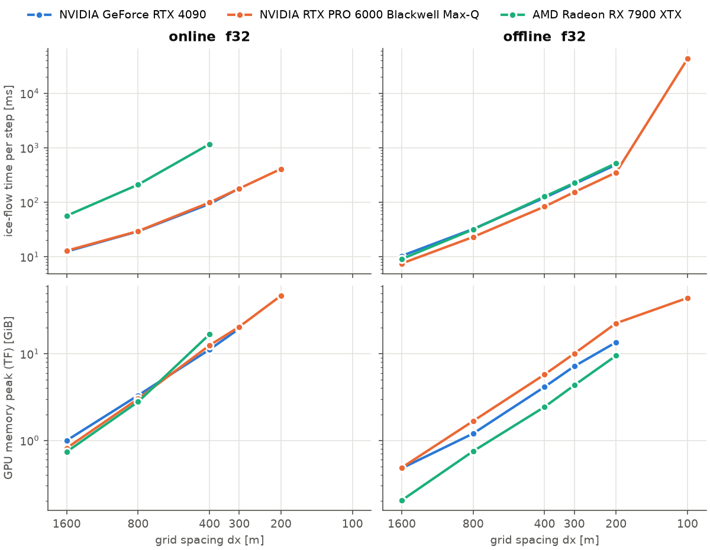

# IGM GPU benchmark

Speed and memory of the ice-flow solver of [IGM](https://github.com/instructed-glacier-model/igm) on one GPU,
to compare GPUs. Every GPU runs the same configurations; only the cost is measured.



## What is run

The European Alps (900 × 600 km, 100 m bed in `data/input_bench.nc`), ice-free start, constant SMB, 100 model
years with 1-yr steps, on five grids:

| Δx | 1600 m | 800 m | 400 m | 300 m | 200 m |
|---|---|---|---|---|---|
| cells | 0.21 M | 0.85 M | 3.4 M | 6.0 M | 13.6 M |

and two ice-flow cases, in float32, the whole grid in one frame:

| case | network | per step |
|---|---|---|
| `online_f32` | dahunet 6 × 24, random initial weights | 1 Adam iteration (training) |
| `offline_f32` | pretrained `dahunet_mini` (8 × 48), shipped with IGM | inference only |

The setup is the scalability test of the IGM v3.2.1 description paper, with shorter runs.

## Install

IGM 3.2.1, which brings TensorFlow 2.17:

```bash
conda create -n igm python=3.12 -y && conda activate igm
pip install igm-model==3.2.1
```

This covers NVIDIA GPUs up to Hopper (e.g. V100, RTX 4090, A100, H100). TensorFlow 2.17 has no kernels for
Blackwell GPUs (RTX PRO 6000, B200, DGX Spark) nor ARM hosts: there, use an NVIDIA NGC TensorFlow container
(e.g. `nvcr.io/nvidia/tensorflow:25.02-tf2-py3`), keep its TensorFlow, and set `TF_USE_LEGACY_KERAS=0`:

```bash
pip install --user --no-deps igm-model==3.2.1
pip install --user "numpy>=1.26,<2.0" matplotlib scipy "netCDF4>=1.6.5" xarray rasterio pyproj geopandas \
    oggm salem pyyaml importlib_resources tqdm hydra-core omegaconf nvtx typeguard rich "optuna>=3.0"
```

AMD GPUs (ROCm): AMD's TensorFlow 2.17 image with IGM on top, `docker/Dockerfile.rocm`. Run inside the container,
with the GPU passed through:

```bash
docker build -t igm-bench:rocm -f docker/Dockerfile.rocm docker/
docker run --rm -it --device /dev/kfd --device /dev/dri \
    --group-add $(getent group video | cut -d: -f3) --group-add $(getent group render | cut -d: -f3) \
    --security-opt seccomp=unconfined --ipc=host --user $(id -u):$(id -g) \
    -e HOME=/bench/outputs/.home -v $PWD:/bench -w /bench igm-bench:rocm ./run_bench.py --quick
```

`run_bench.py` reads the GPU memory from `nvidia-smi` on NVIDIA and from the amdgpu sysfs files on AMD.

## Run

From this folder, on an idle GPU:

```bash
./run_bench.py --quick     # smoke test, a few minutes
./run_bench.py             # full benchmark, about 30-60 min
./plot_bench.py            # figure and table of all results/*/
```

`./run_bench.py -h` lists the options (`--gpu`, `--label`, `--cases`, `--ratios`, ...). Results go to
`results/<label>/` (`results.csv`, `meta.json`), raw IGM runs and logs to `outputs/`. A case stops at its first
grid that runs out of memory.

## Results

Ice-flow time per step (ms) / TensorFlow memory peak (GiB):

| GPU | online, 400 m | online, 200 m | offline, 400 m | offline, 200 m |
|---|---|---|---|---|
| [RTX 4090](results/rtx_4090) (24 GB) | 93 / 11.2 | OOM | 122 / 4.2 | 489 / 13.5 |
| [RTX PRO 6000 Blackwell Max-Q](results/rtx_pro_6000_blackwell_max_q) (96 GB) | 99 / 12.5 | 409 / 46.7 | 83 / 5.8 | 351 / 22.5 |
| [AMD Radeon RX 7900 XTX](results/rx_7900_xtx) (24 GB) | 1168 / 16.8 | OOM (at 300 m) | 128 / 2.4 | 521 / 9.5 |

The NVIDIA GPUs with TensorFlow 2.17 and IGM `d368b9e6`, whose code for these cases is that of v3.2.1; the AMD GPU
with TensorFlow 2.17.1 (ROCm 7.0.2) and IGM 3.2.1.

On the RX 7900 XTX, inference (offline) is on par with the RTX 4090, but training (online) is 5-12× slower: the
convolution gradient with respect to the weights is slow in MIOpen on this GPU (next section). Online at 300 m
first aborts on MIOpen's 4 GiB work-buffer cap; with `TF_CUDNN_WORKSPACE_LIMIT_IN_MB=12288` it runs out of
memory (the RTX 4090 runs it).

The 100 m points of the figure (`--ratios 1`, 54 M cells) are slow: once an activation tensor exceeds 2³¹
elements, the convolutions fall back to much slower kernels (about 40×). The memory peak includes cuDNN/XLA
work buffers, which grow with the memory available: the grid at which a case runs out of memory is the more
robust memory figure.

## What TensorFlow gets from the GPU

`scripts/ceilings.py` measures, in the same TensorFlow, the streaming bandwidth, a float32 matrix product, and
3×3 convolutions shaped like the dahunet layers on the 400 m grid (C → C channels, forward and both
gradients), as achieved TFLOP/s (`results/<label>/ceilings.json`). It tells how much of the hardware the
software stack reaches, and which operation limits the ice flow.

| GPU | copy GB/s (spec) | matmul TFLOP/s (spec) | conv C=24: fwd / ∂input / ∂weights | conv C=48: fwd / ∂input / ∂weights |
|---|---|---|---|---|
| AMD Radeon RX 7900 XTX | 673 (960) | 25.6 (61.4, dual-issue) | 11.9 / 11.5 / **0.26** | 17.8 / 19.2 / **0.99** |

To be completed with the NVIDIA GPUs.

## Add your GPU

Run the full benchmark and `./scripts/ceilings.py --label <label>`, check `results/<label>/meta.json`, run
`./plot_bench.py`, and open a pull request with `results/<label>/`, the figure and a row in the tables above.

## Metrics

| column of `results.csv` | meaning |
|---|---|
| `iceflow_s` | ice-flow time per step (s), median over steps 2…N, GPU-synchronised |
| `step_s` | whole time step (s), same median |
| `tf_peak_gib` | TensorFlow memory peak (GiB) |
| `smi_peak_gib` | memory peak of the whole GPU (GiB) from nvidia-smi or amdgpu sysfs, when reported |
| `first_step_s` | first step, including the XLA compilation |
| `status` | `ok`, `OOM`, `TIMEOUT` or `FAIL` (see `outputs/<label>/<case>_rNN.log`) |

TensorFlow runs GPU work asynchronously; two small IGM user modules (`user/`) wait for the GPU after the ice
flow and at the end of each step, so that the times include it.

## Data and license

Bed topography: SRTM DEM (Farr et al., 2007) with lakes and present-day glaciers removed (Farinotti et al.,
2019), as in Jouvet et al. (2023, doi:10.1017/jog.2023.74). Code under the GNU GPL v3 (`LICENSE`).
